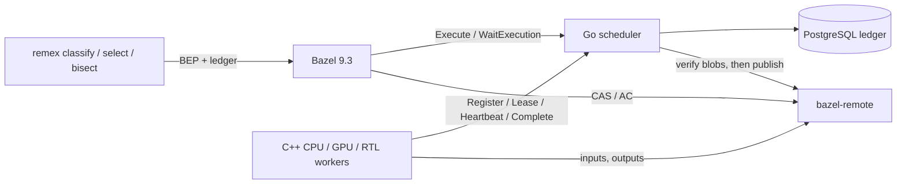

# remex: a study of a Bazel remote-execution scheduler

remex is a scheduler for Bazel remote execution (REAPI v2), with C++ workers
and a CLI that hunts regressions. It studies how a scheduler keeps results
durable and builds moving when a cache, a worker or the scheduler itself is
slow or crashes. The idea: report a result only once it is durable in a
PostgreSQL ledger, cache it only after every output is found in the CAS, and
fence every attempt with a lease, so that a fault costs time, not lost work.

**Scope:** one host (Intel Core i9-13900K, RTX 4090) runs everything, with
the unmodified `bazel-remote` as CAS and action cache. Workloads: one small
C++ workspace (90 actions), synthetic load-test workers, simulated bisection
histories, and one run on a synthetic CUDA history.

## Results

| Measure | remex | Baseline | Better |
|---|---|---|---|
| Cold build and test of `samples/cpp-history`, median of 5 | 8.7 s | Local Bazel, same 4 cores: 6.7 s | Local |
| Warm build (cache hits, tests rerun), median of 5 | 3.9 s | Local Bazel: 3.3 s | Local |
| Scheduler SIGKILLed while an action uploads 64 MiB: kill to build done, median of 5 | 2.2 s | Earlier worker, which re-ran the action: 13.8 s | remex |
| PostgreSQL ledger, 64 synthetic workers: actions/s, median of 5 | 1,479 | Earlier remex, one commit per mutation: 117 | remex |
| Flaky bisect, failure rate 0.25, 1,000 simulated histories: correct | 95.5% | `git bisect run`, `exit 125` on infrastructure failures: 0.9% | remex |
| The same bisections: median test runs | 275 | `git bisect run`, 30 reruns per revision: 186 | Reruns |

Sources in `results/`: `cpu-build.jsonl` (rows 1–2),
`scheduler-restart.jsonl` (row 3), `control-plane.jsonl` against the
empty-history `per-mutation` runs of `control-plane-per-mutation*.jsonl` and
`control-plane-group-commit.jsonl` (row 4), `bisect-simulation.jsonl`
(rows 5–6). The 30 reruns, picked for the true failure rate, are also right
more often (99.8%) but wrong 0.1% of the time; remex was never wrong there
and answered inconclusive 4.5% of the time.

## Limitations

- **Slower than local Bazel here.** With the workers sharing the client's
  four cores, cold builds take 1.3 times as long as local ones and warm
  builds 1.2 times. Nothing here is measured on a cluster.
- **Tuned reruns beat the bisect when the failure rate is known.** At each
  simulated rate they cost fewer runs and are right at least as often.
  remex does not need the rate, and it was wrong once in 16,000 bisections.
- **One leader, one lock.** One scheduler process; there is no
  replication. A crash stalls builds until a supervisor restarts it.
  Running attempts survive an outage shorter than their lease; a longer one
  re-runs them.
- **Narrow comparisons.** Only against local Bazel, `git bisect` and earlier
  versions of remex. No other REAPI scheduler (Buildbarn, Buildfarm,
  NativeLink) was run on the same builds.
- **Thin hardware evidence.** The GPU performance bisect is one run on a
  synthetic history. The planted CUDA race and RTL bug fail by seed,
  deterministically; no test here depends on real nondeterminism in GPU
  scheduling.

More: [how it works](#how-it-works) and [docs/design.md](docs/design.md);
[design trade-offs](docs/design-tradeoffs.md), with measurements of the
designs they replaced; [every benchmark in full](docs/benchmarks.md) and
[what each result file measured](results/README.md); [running it](#run-it).

## How it works

remex has four parts:
- a Go scheduler with a PostgreSQL ledger;
- C++20 workers that run actions in cgroups on CPU, GPU (CUDA) and RTL
  (Verilator) pools; a GPU worker reads its device's identity from NVML
  before it leases and again before it runs;
- the unmodified `bazel-remote` as CAS and action cache;
- a CLI that classifies test failures, selects which hardware tests a change
  needs, and bisects failures that only happen some of the time and
  performance regressions.



- **Fenced leases.** Every attempt has a `(worker, epoch)` lease, renewed by
  heartbeat.
  - A Complete is accepted only at the current epoch, and only if the worker
    reports the attempt's cgroup empty, so that no process should still be
    writing. The scheduler takes the worker's word for that.
  - Every output blob must be present in the CAS; the scheduler checks this
    itself.
  - An expired lease bumps the epoch and retries the action, up to three
    attempts.
- **Commit, then publish.**
  - A result is first made durable in the ledger, and only then written to
    the action cache. A crash in between leaves a committed result that is
    re-verified and published on recovery.
  - Hardware tests and failed results are never cached.
  - The CAS check is not a pin: bazel-remote can still evict a blob after
    it, and its own dependency checks on cache reads are the guard.
- **The ledger** lives in memory behind one lock and is persisted to
  PostgreSQL by group commit: a mutation applies its change in memory and
  queues it, one writer makes everything queued during its previous write
  durable in one transaction, and a call answers once everything it observed
  is durable. The scheduler fail-stops if a ledger write fails, and it
  reloads on restart.

### Bisecting flaky failures

A plain `git bisect run` runs each revision once. A test that fails one time
in four therefore looks fixed on most revisions where it is broken, and the
bisect names the wrong commit.

`remex bisect` works differently:
1. It calibrates on the known-bad revision until it has failed 10 times.
2. It takes a Clopper–Pearson lower bound on the failure rate.
3. It runs every probe enough times that a bad revision passes with
   probability at most α = 0.05.
4. It confirms the final boundary with fresh runs on each side.

Infrastructure failures cost budget but are never counted as evidence. When
the evidence does not support an answer, it says so.

[docs/design.md](docs/design.md) covers the state machine, the failure model
and the regression algorithms.

## Run it

```bash
scripts/bootstrap-bazel.sh && scripts/bootstrap-go.sh       # pinned Bazel 9.3 and Go
make all             # scheduler, CLI and worker (CMake; `make worker-bazel` builds the worker with Bazel)
make test            # Go tests with -race, the worker's ctest, and the Python tests
scripts/run-local.sh # PostgreSQL + bazel-remote (Docker Compose), scheduler, 2 CPU + 1 RTL worker
scripts/bazel-sample.sh cpp-history   # in another terminal: a remote Bazel build and test
```

- **Requirements:** Linux x86-64, Go (the version in `go.mod`), Python 3,
  Docker Compose, CMake and a C++20 compiler, the gRPC, protobuf, OpenSSL
  and Abseil development packages, and a delegated cgroup v2 subtree for the
  current user. On Ubuntu 24.04 the packages are `cmake g++ libgrpc++-dev
  libprotobuf-dev protobuf-compiler protobuf-compiler-grpc libssl-dev
  libabsl-dev`. The fault tests also need `psql`.
- **CI** (`.github/workflows/ci.yml`) runs `make go-vet` and `make go-test`
  against a PostgreSQL service, `make worker-test`, and `make python-test`.
  An `integration` job adds bazel-remote service containers and a delegated
  cgroup subtree so that the scheduler, worker and fault tests that skip
  without them run, and fails if any of them skips. It has not run on
  GitHub; on the development host the same tests pass against containers
  with the same settings. Only the GPU (NVML) tests need a GPU host.
- **GPU workers** (`REMEX_GPU=1`) also need an NVIDIA driver with NVML.
- **Fault tests.** `tests/faults` holds fault-injection tests against real
  processes:
  - SIGKILL of the scheduler during Bazel builds;
  - a CAS that loses blobs or rejects writes;
  - workers killed or stopped mid-action;
  - duplicate and lost Complete responses.

## Layout

| Path | What it is |
|---|---|
| `scheduler/` | REAPI Execution service, worker protocol, ledger, PostgreSQL store |
| `worker/` | C++20 worker: lease loop, CAS client and cache, cgroup execution, NVML |
| `regress/`, `cmd/remex` | classify, select, bisect and export-bundle |
| `checker/` | independent gRPC recorder and invariant checker |
| `cmd/remex-loadtest`, `cmd/remex-bisectsim` | the benchmarks above |
| `results/` | benchmark and fault-test records ([results/README.md](results/README.md)) |
| `samples/` | C++ (with Abseil), CUDA and RTL Bazel workspaces used by the tests and the planted history |
| `deploy/` | Compose file and Dockerfiles |
| `docs/` | design, design trade-offs and the full benchmarks |

## Design limits

- **A failed ledger write stops the scheduler.** Group commit applies changes
  in memory before they are durable, so a write that fails cannot be undone
  in place: the scheduler fail-stops and a restart serves the durable prefix.
- **Workers are trusted.** The scheduler checks epochs, leases, attempt
  directories and CAS contents itself, but takes the worker's word for an
  empty cgroup, OOM counts and the GPU identity it reads from NVML. There is
  no authentication and no sandbox; the deployment is for one trusted team.
- **NVML is used for identity only.** A GPU worker reads one device's UUID,
  compute capability and driver version (`worker/src/nvml.cc`) and refuses
  to register if NVML shows more than one device, so multi-GPU hosts and
  MIG are unsupported. It reads no clocks, temperatures, utilization or
  memory; the performance bisection gets those from `nvidia-smi`.
- **Workers.** One action per worker process. The CAS client issues one
  request per blob, so a cold remote build pays a round trip per blob, and
  each worker keeps its own unbounded blob cache. An idle worker holds a
  Lease for up to 1 s, and every waiting Lease wakes whenever any
  execution becomes runnable, so with many idle workers of other pools
  most of them wake for nothing. A worker starts a command only once the
  scheduler has durably recorded RUNNING.
- **Failure signature.** Classification uses a `REMEX_SIGNATURE:` line or the
  digest of the whole test log. Real logs with timestamps need a
  normalising signature to bisect.
- **Hardware test selection** keeps every hardware test that
  `target-determinator` reports as affected. It is a safe filter, not a
  learned predictor.
