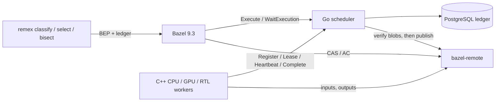

# remex: Bazel remote execution with flaky-regression bisection

remex is a Bazel remote-execution service (REAPI v2), plus regression tooling
built on it. The system has four parts:
- a Go scheduler with a PostgreSQL ledger;
- C++20 workers that run actions in cgroups on CPU, GPU (CUDA) and RTL
  (Verilator) pools; a GPU worker reads its device identity from NVML before
  it leases and again before it runs;
- the unmodified `bazel-remote` as CAS and action cache;
- a CLI that classifies test failures, selects which hardware tests a change
  needs, and bisects failures that only happen some of the time.

Two properties matter most. A result is reported only once it is durable,
and it is written to the action cache only after the scheduler has found
every output blob in the CAS. And a slow or failing component costs time,
not lost work.

**Control plane under load.** `cmd/remex-loadtest` drives the scheduler in
process: 64 synthetic workers loop Lease → Heartbeat → Complete against a
ledger that already holds 0–5,000 finished executions, while a probe worker
heartbeats one long-running action every 100 ms. `-stall 3s` makes every
action-cache write take 3 s, and `-queue N` keeps N runnable actions queued
ahead of the workers. `scripts/bench-control-plane.sh` ran each cell five
times for 20 s (`results/control-plane.jsonl`); actions per second are the
median with the range over the five runs:

| Store | History | Queued | AC write stall | Actions/s | Probe heartbeat, median / worst | Attempts lost |
|---|---|---|---|---|---|---|
| PostgreSQL | 0 | – | – | 1,479 (1,173–1,592) | <0.01 ms / 3.3–5.7 ms | 0 |
| PostgreSQL | 1,000 | – | – | 1,500 (1,272–1,603) | <0.01 ms / 3.1–9.4 ms | 0 |
| PostgreSQL | 1,000 | – | 3 s | 21 | <0.01 ms / 3.0–3.7 ms | 0 |
| memory | 0 | – | – | 25,863 (22,077–27,511) | <0.02 ms / 49–249 ms | 0 |
| memory | 1,000 | – | – | 27,030 (19,168–28,389) | <0.02 ms / 37–177 ms | 0 |
| memory | 5,000 | – | – | 26,334 (20,586–27,406) | <0.02 ms / 33–303 ms | 0 |
| memory | 1,000 | – | 3 s | 21 | <0.02 ms / 0.05–0.07 ms | 0 |
| memory | 0 | 1,000 | – | 26,683 (24,183–29,480) | <0.01 ms / 73–221 ms | 0 |
| memory | 0 | 10,000 | – | 26,603 (24,797–27,736) | <0.01 ms / 24–197 ms | 0 |
| memory | 0 | 50,000 | – | 25,684 (24,895–28,986) | <0.01 ms / 81–321 ms | 0 |

- **A slow cache.** With every action-cache write stalled for 3 s, each
  worker waits for its own write, so 64 workers cap the loop at
  64 / 3 s ≈ 21 actions/s. Nobody else waits: publication calls the cache
  outside the scheduler lock, the probe's heartbeats stay under 4 ms, and no
  lease expires.
- **Group commit** puts 27.5 ledger changes in each PostgreSQL transaction
  on average, and a call answers once everything it observed is durable.
  Each synthetic worker still waits for its own commits, so the loop is
  bound by commit latency: more concurrent workers make bigger groups. With
  the in-memory store there is no fsync to share.
- **Deep queues.** Lease takes the oldest action from a per-platform queue,
  so throughput does not depend on how much work is queued. Sorting every
  runnable action on each Lease, as the scheduler did before, completed a
  median of 1,640, 162 and 26 actions/s with 1,000, 10,000 and 50,000
  queued, and the probe's heartbeat then waited up to 3.3 s
  (`results/control-plane-deep-queue-sorted.jsonl`).
- **What this does not show.** Arrival is closed-loop: every worker submits
  one action and then runs one, so there is no open-loop arrival rate. The
  probe's heartbeats change nothing and get CONTINUE, one of the two answers
  allowed to skip the durability wait ([docs/design.md](docs/design.md)).
  With the in-memory store the worst probe heartbeat is tens to hundreds of
  milliseconds in every cell, queued work or not. Ranges are over five
  runs, not confidence intervals.
- **Where.** One host: Intel Core i9-13900K (32 threads), 123 GiB of RAM,
  a Samsung 990 EVO Plus NVMe, Linux 7.0, Go 1.27.2, and PostgreSQL 18.6 in
  a container with default settings (fsync and synchronous_commit on,
  wal_sync_method fdatasync, shared_buffers 128MB). Every record carries its
  environment and the commit it measured.

**Scheduler restart.** `tests/faults/bazel_restart_test.py` runs a real
Bazel 9.3 build against a scheduler with a PostgreSQL ledger and 2 s leases,
SIGKILLs the scheduler at a chosen phase, and restarts it 0.8 s later. Five
runs per phase (`results/scheduler-restart.jsonl`, rows with
`"worker": "after"`):

| Scheduler killed while the action | Same attempt finished | Kill to Bazel done |
|---|---|---|
| runs (an 8 s command) | 5 of 5 | 8.4–8.5 s |
| uploads its 64 MiB output | 5 of 5 | 2.1–3.9 s (median 2.2) |

- **Every other fault keeps its outcome.** A queued action runs once. A
  lease whose response is held past the lease is retried at epoch 2. A
  crash before or after the action-cache write publishes the committed
  result exactly once. Killed and stopped workers are retried.
- **Down longer than the lease (3 s):** a running attempt is abandoned and
  retried. An attempt that had already finished still delivers its result,
  and the restarted scheduler accepts it under the recovered lease.

[docs/design-tradeoffs.md](docs/design-tradeoffs.md) explains why the
scheduler and worker are built this way, including measurements of the
designs they replaced; [results/README.md](results/README.md) lists what
each results file measured.

## Architecture



- **Fenced leases.** Every attempt has a `(worker, epoch)` lease, renewed by
  heartbeat.
  - A Complete is accepted only at the current epoch, and only if the worker
    reports the attempt's cgroup empty, so that no process should still be
    writing. The scheduler takes the worker's word for that.
  - Every output blob must be present in the CAS; the scheduler checks this
    itself.
  - An expired lease bumps the epoch and retries the action, up to three
    attempts.
- **Commit, then publish.**
  - A result is first made durable in the ledger, and only then written to
    the action cache. A crash in between leaves a committed result that is
    re-verified and published on recovery.
  - Hardware tests and failed results are never cached.
  - The CAS check is not a pin: bazel-remote can still evict a blob after
    it, and its own dependency checks on cache reads are the guard.
- **The ledger** lives in memory behind one lock and is persisted to
  PostgreSQL by group commit: a mutation applies its change in memory and
  queues it, one writer makes everything queued during its previous write
  durable in one transaction, and a call answers once everything it observed
  is durable. The scheduler fail-stops if a ledger write fails, and it
  reloads on restart.

[docs/design.md](docs/design.md) covers the state machine, the failure model
and the regression algorithms.

## Bisecting flaky failures

A plain `git bisect run` runs each revision once. A test that fails one time
in four therefore looks fixed on most revisions where it is broken, and the
bisect names the wrong commit.

`remex bisect` works differently:
1. It calibrates on the known-bad revision until it has failed 10 times.
2. It takes a Clopper–Pearson lower bound on the failure rate.
3. It runs every probe enough times that a bad revision passes with
   probability at most α = 0.05.
4. It confirms the final boundary with fresh runs on each side.

Infrastructure failures cost budget but are never counted as evidence. When
the evidence does not support an answer, it says so.

`cmd/remex-bisectsim` runs 1,000 bisections per cell on simulated 1,000-commit
histories. The culprit is placed at random and fails with probability p, and
each run separately hits an infrastructure failure with probability 10%. The
model assumes independent runs, a constant failure rate and one failure
signature. The baselines are `git bisect run` with three probe scripts: one
that only checks the exit code, so an infrastructure failure looks like a
test failure; one that exits 125 on an infrastructure failure, so git skips
that revision; and one that reruns the test until it has N results, retries
infrastructure failures and reports bad at the first test failure, with N
swept from 1 to 100. remex runs with the CLI defaults (α = 0.05, a budget
of 2,000 runs). Results are in `results/bisect-simulation.jsonl`:

| Failure rate p | git bisect, exit code only: correct | git bisect, exit 125: correct | git bisect, smallest N reaching 99% correct: correct / wrong, median runs | **remex: correct / wrong / inconclusive** | remex runs, median (p95) |
|---|---|---|---|---|---|
| 1 | 58% | 81% | N = 1: 100% / 0%, 11 | **100% / 0% / 0%** | 50 (57) |
| 0.5 | 3% | 5% | N = 10: 99.3% / 0.7%, 67 | **96.3% / 0% / 3.7%** | 128 (196) |
| 0.25 | 0.2% | 0.9% | N = 30: 99.8% / 0.1%, 186 | **95.5% / 0% / 4.5%** | 275 (467) |
| 0.1 | 0.1% | 0.3% | N = 100: 99.8% / 0.1%, 609 | **93.7% / 0% / 6.3%** | 725 (1,180) |

- **With the failure rate known, reruns win.** A rerun count picked for the
  true p is right at least as often as remex and costs fewer runs in every
  row, at the price of a few wrong answers (up to 0.7%) where remex gave
  none. `exit 125` alone stops infrastructure noise from blaming the wrong
  commit for a deterministic failure (81% correct, the rest inconclusive),
  but one run per revision still misses flaky failures.
- **remex does not need the failure rate.** One N has to cover the rarest
  flake expected. N = 100 covers p = 0.1 but costs a median of 561 runs on a
  deterministic failure, where remex needs 50; N = 10 is cheap but wrong 85%
  of the time at p = 0.1. remex calibrates on the known-bad revision and
  sizes its probes from that.
- **Wrong is rare; inconclusive is the price.** remex gave no wrong answer in
  any cell above. Zero in 1,000 trials bounds its wrong rate at 0.3% (the
  one-sided 95% Clopper–Pearson bound, `wrong_upper95` in the results);
  across all 16 configurations it was wrong once in 16,000 bisections. Every
  inconclusive answer comes from the final confirmation rejecting the
  boundary the search reached, after a bad revision passed all its runs.
- **Why the bound stays exact.** Stopping at the r-th failure keeps the
  Clopper–Pearson bound exact, because
  P(r-th failure within n runs) = P(Binomial(n, p) ≥ r).

**On real hardware.** `scripts/hardware-corpus.py` generates a 96-commit
history with five planted regressions (deterministic C++, CUDA and RTL bugs,
a seeded CUDA data race and a seeded RTL FIFO occupancy bug) and runs
`remex bisect`, or a one-shot `git bisect run` baseline, on it against real
workers ([samples/hardware-corpus.md](samples/hardware-corpus.md)). The two
flaky defects are seed-gated: each test reads `REMEX_SEED` and takes the
faulty path when SplitMix64(seed) mod 4 is 0
(`samples/cuda/race/race_test.cu`). About one seed in four triggers it, and a
given seed always behaves the same way; the flakiness comes from varying the
seed between runs, not from nondeterministic GPU scheduling. No results from
these hardware runs are included in `results/`.

## Run it

```bash
scripts/bootstrap-bazel.sh && scripts/bootstrap-go.sh       # pinned Bazel 9.3 and Go
make all             # scheduler, CLI and worker (CMake; `make worker-bazel` builds the worker with Bazel)
make test            # Go tests with -race, and the worker's ctest
scripts/run-local.sh # PostgreSQL + bazel-remote (Docker Compose), scheduler, 2 CPU + 1 RTL worker
scripts/bazel-sample.sh cpp-history   # in another terminal: a remote Bazel build and test
```

- **Requirements:** Linux x86-64, Docker Compose, a C++20 compiler, the
  gRPC, protobuf, OpenSSL and Abseil development packages (see
  [worker/README.md](worker/README.md)), and a delegated cgroup v2 subtree
  for the current user.
- **GPU workers** (`REMEX_GPU=1`) also need an NVIDIA driver with NVML.
- **Fault tests.** `tests/faults` holds fault-injection tests against real
  processes:
  - SIGKILL of the scheduler during Bazel builds;
  - a CAS that loses blobs or rejects writes;
  - workers killed or stopped mid-action;
  - duplicate and lost Complete responses.

## Layout

| Path | What it is |
|---|---|
| `scheduler/` | REAPI Execution service, worker protocol, ledger, PostgreSQL store |
| `worker/` | C++20 worker: lease loop, CAS client and cache, cgroup execution, NVML |
| `regress/`, `cmd/remex` | classify, select, bisect and export-bundle |
| `checker/` | independent gRPC recorder and invariant checker |
| `cmd/remex-loadtest`, `cmd/remex-bisectsim` | the benchmarks above |
| `results/` | benchmark and fault-test records ([results/README.md](results/README.md)) |
| `samples/` | C++ (with Abseil), CUDA and RTL Bazel workspaces used by the tests and the planted history |
| `deploy/` | Compose file and Dockerfiles |

## Limitations

- **Single leader.** One scheduler process; there is no replication. A
  crash stalls builds until a supervisor restarts it. Running attempts
  survive an outage shorter than their lease; a longer one re-runs them.
- **A failed ledger write stops the scheduler.** Group commit applies changes
  in memory before they are durable, so a write that fails cannot be undone
  in place: the scheduler fail-stops and a restart serves the durable prefix.
- **Workers are trusted.** The scheduler checks epochs, leases, attempt
  directories and CAS contents itself, but takes the worker's word for an
  empty cgroup, OOM counts and the GPU identity it reads from NVML. There is
  no authentication and no sandbox; the deployment is for one trusted team.
- **Workers.** One action per worker process. The CAS client issues one
  request per blob, so a cold remote build pays a round trip per blob, and
  each worker keeps its own unbounded blob cache. `scripts/benchmark-cpu.py`
  compares cold and warm remote builds with local ones on one host; no
  results from it are included.
- **Failure signature.** Classification uses a `REMEX_SIGNATURE:` line or the
  digest of the whole test log. Real logs with timestamps need a
  normalising signature to bisect.
- **Hardware test selection** keeps every hardware test that
  `target-determinator` reports as affected. It is a safe filter, not a
  learned predictor.
