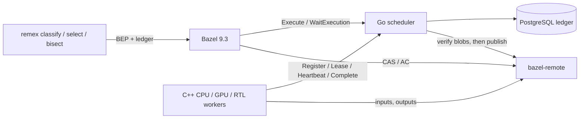

# remex: a study of a Bazel remote-execution scheduler

remex is a scheduler for Bazel remote execution (REAPI v2), built to study
how a scheduler keeps results durable and builds moving when parts of the
system are slow or crash, plus regression tooling on top of it. It has four
parts:
- a Go scheduler with a PostgreSQL ledger;
- C++20 workers that run actions in cgroups on CPU, GPU (CUDA) and RTL
  (Verilator) pools; a GPU worker reads its device's identity from NVML
  before it leases and again before it runs;
- the unmodified `bazel-remote` as CAS and action cache;
- a CLI that classifies test failures, selects which hardware tests a change
  needs, and bisects failures that only happen some of the time and
  performance regressions.

Two properties matter most. A result is reported only once it is durable,
and it is written to the action cache only after the scheduler has found
every output blob in the CAS. And a slow or failing component costs time,
not lost work.

**What it is compared with.** Every comparison below is against an earlier
version of this scheduler, against `git bisect`, or against plain local
Bazel on the same cores. No existing REAPI scheduler (Buildbarn,
Buildfarm, NativeLink) was run on the same builds, so nothing here says how
remex compares with one. The earlier scheduler versions that
`results/` keeps records for are not in this repository's history.

**End-to-end build.** `scripts/benchmark-cpu.py` builds and tests
`samples/cpp-history` (`//:math_test` and `//:abseil_test`: 90 compile, link
and test actions) from `bazel clean`, locally and through remex. PostgreSQL,
bazel-remote, the scheduler, four CPU workers and Bazel all run on the same
four cores (one thread on each of four P-cores), and local builds use four
jobs. Cold builds start from an empty cache, warm builds reuse it, and every
build reruns the tests. Five trials (`results/cpu-build.jsonl`, commit
3f8873f); median wall time with the range:

| Build | Cold | Warm |
|---|---|---|
| Local Bazel, disk cache | 6.5 s (6.2–7.3) | 3.6 s (3.3–3.7) |
| Through remex and bazel-remote | 11.3 s (10.9–12.9) | 3.8 s (3.5–4.5) |

- **Cold remote builds take 1.7 times as long.** The ledger shows the 90
  executions busy on workers for 15–22 s in all, while the scheduler's span
  from the first execution to the last commit was 7.6–9.3 s: the four
  workers were busy 50–59% of it. The median execution waited 67–89 ms
  for a lease, because an idle worker polls Lease every 500 ms rather than
  holding a long poll. The other 3.2–3.6 s of wall time are outside that span:
  Bazel's own work after the clean, uploading inputs before the first action
  and downloading outputs after the last.
- **Warm builds** hit the cache for all 88 compile and link actions and run
  only the two tests remotely; each of those waited 97–194 ms for a lease.
- All 20 builds produced identical test binaries. It is one small workspace
  on one host, with the workers sharing the client's cores; it does not say
  how remex behaves on a cluster.

**Control plane under load.** `cmd/remex-loadtest` drives the scheduler in
process: 64 synthetic workers loop Lease → Heartbeat → Complete against a
ledger that already holds 0–5,000 finished executions, while a probe worker
heartbeats one long-running action every 100 ms. `-stall 3s` makes every
action-cache write take 3 s, and `-queue N` keeps N runnable actions queued
ahead of the workers. `scripts/bench-control-plane.sh` ran each cell five
times for 20 s (`results/control-plane.jsonl`, at commit 25d4067, before the
deadline heap described below); actions per second are the median with the
range over the five runs:

| Store | History | Queued | AC write stall | Actions/s | Probe heartbeat, median / worst | Attempts lost |
|---|---|---|---|---|---|---|
| PostgreSQL | 0 | – | – | 1,479 (1,173–1,592) | <0.01 ms / 3.3–5.7 ms | 0 |
| PostgreSQL | 1,000 | – | – | 1,500 (1,272–1,603) | <0.01 ms / 3.1–9.4 ms | 0 |
| PostgreSQL | 1,000 | – | 3 s | 21 | <0.01 ms / 3.0–3.7 ms | 0 |
| memory | 0 | – | – | 25,863 (22,077–27,511) | <0.02 ms / 49–249 ms | 0 |
| memory | 1,000 | – | – | 27,030 (19,168–28,389) | <0.02 ms / 37–177 ms | 0 |
| memory | 5,000 | – | – | 26,334 (20,586–27,406) | <0.02 ms / 33–303 ms | 0 |
| memory | 1,000 | – | 3 s | 21 | <0.02 ms / 0.05–0.07 ms | 0 |
| memory | 0 | 1,000 | – | 26,683 (24,183–29,480) | <0.01 ms / 73–221 ms | 0 |
| memory | 0 | 10,000 | – | 26,603 (24,797–27,736) | <0.01 ms / 24–197 ms | 0 |
| memory | 0 | 50,000 | – | 25,684 (24,895–28,986) | <0.01 ms / 81–321 ms | 0 |

- **A slow cache.** With every action-cache write stalled for 3 s, each
  worker waits for its own write, so 64 workers cap the loop at
  64 / 3 s ≈ 21 actions/s. Nobody else waits: publication calls the cache
  outside the scheduler lock, the probe's heartbeats stay under 4 ms, and no
  lease expires.
- **Group commit** puts 27.5 ledger changes in each PostgreSQL transaction
  on average, and a call answers once everything it observed is durable.
  Each synthetic worker still waits for its own commits, so the loop is
  bound by commit latency: more concurrent workers make bigger groups. With
  the in-memory store there is no fsync to share.
- **Deep queues.** Lease takes the oldest action from a per-platform queue,
  so throughput does not depend on how much work is queued. Sorting every
  runnable action on each Lease, as the scheduler did before, completed a
  median of 1,640, 162 and 26 actions/s with 1,000, 10,000 and 50,000
  queued, and the probe's heartbeat then waited up to 3.3 s
  (`results/control-plane-deep-queue-sorted.jsonl`).
- **What this does not show.** Arrival is closed-loop: every worker submits
  one action and then runs one, so there is no open-loop arrival rate. The
  probe's heartbeats change nothing and get CONTINUE, one of the two answers
  allowed to skip the durability wait ([docs/design.md](docs/design.md)).
  With the in-memory store the worst probe heartbeat is tens to hundreds of
  milliseconds in every cell, queued work or not; the worker sweep below
  shows why. Ranges are over five runs, not confidence intervals.
- **Where.** One host: Intel Core i9-13900K (32 threads), 123 GiB of RAM,
  a Samsung 990 EVO Plus NVMe, Linux 7.0, Go 1.27.2, and PostgreSQL 18.6 in
  a container with default settings (fsync and synchronous_commit on,
  wal_sync_method fdatasync, shared_buffers 128MB). Every record carries its
  environment and the commit it measured.

**More workers.** Lease, Heartbeat and Complete used to scan every live
attempt's lease deadline under the scheduler lock; they now keep deadlines
in a min-heap with a per-worker index. `REMEX_BENCH_MATRIX=workers
scripts/bench-control-plane.sh` runs the empty-history cells with 64, 512
and 4,096 workers: five runs with the heap
(`results/control-plane-workers.jsonl`) and three of the scanning scheduler
(`results/control-plane-workers-deadline-scan.jsonl`, commit f30b45c):

| Store | Workers | Actions/s, heap | Actions/s, scan | Probe heartbeat median / worst, heap | Same, scan |
|---|---|---|---|---|---|
| memory | 64 | 27,770 (24,838–30,548) | 21,729 (19,227–26,245) | <0.01 ms / 33–211 ms | 0.01 ms / 109–191 ms |
| memory | 512 | 27,918 (23,675–28,962) | 15,351 (13,462–17,037) | 2.2 ms / 35–276 ms | 4.3 ms / 54–114 ms |
| memory | 4,096 | 23,559 (20,818–24,761) | 3,361 (3,015–4,193) | 23 ms / 112–204 ms | 154 ms / 205–350 ms |
| PostgreSQL | 64 | 1,268 (1,188–1,425) | 1,410 (1,184–1,479) | <0.01 ms / 2–10 ms | <0.01 ms / 2–14 ms |
| PostgreSQL | 512 | 2,680 (1,977–2,707) | 2,550 (2,069–2,721) | <0.01 ms / 20–43 ms | 0.01 ms / 11–39 ms |
| PostgreSQL | 4,096 | 3,165 (2,874–3,419) | 2,718 (2,520–2,908) | <0.01 ms / 75–217 ms | 16 ms / 322–381 ms |

- **The scan grew with the workers.** With 4,096 workers on the in-memory
  store the heap completes 7.0 times as many actions per second as the scan
  did, and the probe's median heartbeat drops from 154 ms to 23 ms. At 64
  workers the ranges overlap. With PostgreSQL every worker waits for its own
  commits either way, and throughput rises with the worker count because
  groups get bigger.
- **What makes the worst heartbeat slow.** Each record counts, for every
  probe heartbeat over 10 ms, whether a commit reallocated the ledger's
  event log or a GC cycle ended while it waited. The in-memory ledger keeps
  all events in one slice of 96-byte entries; a 20 s run reaches 3.5–4.3
  million events, and each of the 45–46 times the slice outgrows its
  capacity, a commit copies all of it, up to about 300 MB, under the lock.
  With 64 workers the slowest heartbeat of every run waited on such a copy,
  as did 21 of the 29 over 10 ms; one of those also overlapped the end of a
  GC cycle. With GC
  off (`GOGC=off`, 10 s runs) all 7 slow heartbeats were copies. GC
  stop-the-world pauses stayed at or below 3.7 ms. PostgreSQL runs build a
  ledger about twenty times smaller (0.17–0.2 million events), and their
  worst heartbeat at 64 workers is 2–10 ms. At 4,096 workers most of the
  delay is waiting for the lock: 487 heartbeats over 10 ms, 42 during a
  copy and 40 during GC, and the longest GC pause fell in the runtime's
  histogram bucket that ends at 101 ms.
  Copying the whole event log on growth is a cost of keeping the ledger in
  one slice; a chunked log would remove it, and is not implemented.

**Scheduler restart.** `tests/faults/bazel_restart_test.py` runs a real
Bazel 9.3 build against a scheduler with a PostgreSQL ledger and 2 s leases,
SIGKILLs the scheduler at a chosen phase, and restarts it 0.8 s later. Five
runs per phase (`results/scheduler-restart.jsonl`, rows with
`"worker": "after"`):

| Scheduler killed while the action | Same attempt finished | Kill to Bazel done |
|---|---|---|
| runs (an 8 s command) | 5 of 5 | 8.4–8.5 s |
| uploads its 64 MiB output | 5 of 5 | 2.1–3.9 s (median 2.2) |

- **Every other fault keeps its outcome.** A queued action runs once. A
  lease whose response is held past the lease is retried at epoch 2. A
  crash before or after the action-cache write publishes the committed
  result exactly once. Killed and stopped workers are retried.
- **Down longer than the lease (3 s):** a running attempt is abandoned and
  retried. An attempt that had already finished still delivers its result,
  and the restarted scheduler accepts it under the recovered lease.

[docs/design-tradeoffs.md](docs/design-tradeoffs.md) explains why the
scheduler and worker are built this way, including measurements of the
designs they replaced; [results/README.md](results/README.md) lists what
each results file measured.

## Architecture



- **Fenced leases.** Every attempt has a `(worker, epoch)` lease, renewed by
  heartbeat.
  - A Complete is accepted only at the current epoch, and only if the worker
    reports the attempt's cgroup empty, so that no process should still be
    writing. The scheduler takes the worker's word for that.
  - Every output blob must be present in the CAS; the scheduler checks this
    itself.
  - An expired lease bumps the epoch and retries the action, up to three
    attempts.
- **Commit, then publish.**
  - A result is first made durable in the ledger, and only then written to
    the action cache. A crash in between leaves a committed result that is
    re-verified and published on recovery.
  - Hardware tests and failed results are never cached.
  - The CAS check is not a pin: bazel-remote can still evict a blob after
    it, and its own dependency checks on cache reads are the guard.
- **The ledger** lives in memory behind one lock and is persisted to
  PostgreSQL by group commit: a mutation applies its change in memory and
  queues it, one writer makes everything queued during its previous write
  durable in one transaction, and a call answers once everything it observed
  is durable. The scheduler fail-stops if a ledger write fails, and it
  reloads on restart.

[docs/design.md](docs/design.md) covers the state machine, the failure model
and the regression algorithms.

## Bisecting flaky failures

A plain `git bisect run` runs each revision once. A test that fails one time
in four therefore looks fixed on most revisions where it is broken, and the
bisect names the wrong commit.

`remex bisect` works differently:
1. It calibrates on the known-bad revision until it has failed 10 times.
2. It takes a Clopper–Pearson lower bound on the failure rate.
3. It runs every probe enough times that a bad revision passes with
   probability at most α = 0.05.
4. It confirms the final boundary with fresh runs on each side.

Infrastructure failures cost budget but are never counted as evidence. When
the evidence does not support an answer, it says so.

`cmd/remex-bisectsim` runs 1,000 bisections per cell on simulated 1,000-commit
histories. The culprit is placed at random and fails with probability p, and
each run separately hits an infrastructure failure with probability 10%. The
model assumes independent runs, a constant failure rate and one failure
signature. The baselines are `git bisect run` with three probe scripts: one
that only checks the exit code, so an infrastructure failure looks like a
test failure; one that exits 125 on an infrastructure failure, so git skips
that revision; and one that reruns the test until it has N results, retries
infrastructure failures and reports bad at the first test failure, with N
swept from 1 to 100. remex runs with the CLI defaults (α = 0.05, a budget
of 2,000 runs). Results are in `results/bisect-simulation.jsonl`:

| Failure rate p | git bisect, exit code only: correct | git bisect, exit 125: correct | git bisect, smallest N reaching 99% correct: correct / wrong, median runs | **remex: correct / wrong / inconclusive** | remex runs, median (p95) |
|---|---|---|---|---|---|
| 1 | 58% | 81% | N = 1: 100% / 0%, 11 | **100% / 0% / 0%** | 50 (57) |
| 0.5 | 3% | 5% | N = 10: 99.3% / 0.7%, 67 | **96.3% / 0% / 3.7%** | 128 (196) |
| 0.25 | 0.2% | 0.9% | N = 30: 99.8% / 0.1%, 186 | **95.5% / 0% / 4.5%** | 275 (467) |
| 0.1 | 0.1% | 0.3% | N = 100: 99.8% / 0.1%, 609 | **93.7% / 0% / 6.3%** | 725 (1,180) |

- **With the failure rate known, reruns win.** A rerun count picked for the
  true p is right at least as often as remex and costs fewer runs in every
  row, at the price of a few wrong answers (up to 0.7%) where remex gave
  none. `exit 125` alone stops infrastructure noise from blaming the wrong
  commit for a deterministic failure (81% correct, the rest inconclusive),
  but one run per revision still misses flaky failures.
- **remex does not need the failure rate.** One N has to cover the rarest
  flake expected. N = 100 covers p = 0.1 but costs a median of 561 runs on a
  deterministic failure, where remex needs 50; N = 10 is cheap but wrong 85%
  of the time at p = 0.1. remex calibrates on the known-bad revision and
  sizes its probes from that.
- **Wrong is rare; inconclusive is the price.** remex gave no wrong answer in
  any cell above. Zero in 1,000 trials bounds its wrong rate at 0.3% (the
  one-sided 95% Clopper–Pearson bound, `wrong_upper95` in the results);
  across all 16 configurations it was wrong once in 16,000 bisections. Every
  inconclusive answer comes from the final confirmation rejecting the
  boundary the search reached, after a bad revision passed all its runs.
- **Why the bound stays exact.** Stopping at the r-th failure keeps the
  Clopper–Pearson bound exact, because
  P(r-th failure within n runs) = P(Binomial(n, p) ≥ r).

**A performance regression on the RTX 4090.** With `bisect.metric` set,
remex bisects a measured value instead of a failure (`regress/metric.go`):
it measures both endpoints, classifies each probed revision by which
endpoint's median its values are nearer, and requires a one-sided
Mann–Whitney U p-value below α against the other endpoint's values (checked
against scipy in `regress/testdata/scipy-reference.json`).
`scripts/perf-history.py` generates a 40-commit Bazel CUDA workspace whose
test transposes a 4096 × 4096 matrix and prints the median time of 100
launches. Commit 26 drops the shared-memory tile, so each warp's writes are
no longer coalesced; the output stays correct and the test keeps passing.
One run on real workers, the test compiled on a CPU worker and run on the GPU
worker (`results/cuda-perf-bisect.json`):

| | Revisions measured | Runs | Median kernel time | Result |
|---|---|---|---|---|
| Known good, index 0 | 1 | 10 | 0.1565 ms | |
| Known bad, index 39 | 1 | 10 | 0.4701 ms | p = 8×10⁻⁵ |
| Search | 19, 29, 24, 26, 25 | 50 | 0.1565 / 0.4700 ms | good, bad, good, bad, good |
| Confirmation | 25 and 26 | 40 | 0.1565 / 0.4700 ms | p = 6×10⁻⁶ and 3×10⁻⁶ |

- It named commit 26, the planted one, after 110 test runs in 356 s, all
  inside one 6-minute hold of the GPU lock. `nvidia-smi` after every run
  read P0, SM 2,520 MHz, 38–45 °C and 51–60 W; clocks were not locked.
- The slowdown is large (3.0 times), so this shows the pipeline working on
  real hardware rather than how small a change it can find. Kernel times
  repeat to the timer's resolution, so the p-values come from the normal
  approximation with ties; each is per probe, with no correction across
  the search.

**Planted failures on real hardware.** `scripts/hardware-corpus.py`
generates a 96-commit history with five planted regressions (deterministic
C++, CUDA and RTL bugs, a seeded CUDA data race and a seeded RTL FIFO
occupancy bug) and runs `remex bisect`, or a one-shot `git bisect run`
baseline, on it against real workers
([samples/hardware-corpus.md](samples/hardware-corpus.md)). The two flaky
defects are seed-gated: each test reads `REMEX_SEED` and takes the faulty
path when SplitMix64(seed) mod 4 is 0 (`samples/cuda/race/race_test.cu`).
About one seed in four triggers it, and a given seed always behaves the same
way; the flakiness comes from varying the seed between runs, not from
nondeterministic GPU scheduling. No results from these runs are in
`results/`.

## Run it

```bash
scripts/bootstrap-bazel.sh && scripts/bootstrap-go.sh       # pinned Bazel 9.3 and Go
make all             # scheduler, CLI and worker (CMake; `make worker-bazel` builds the worker with Bazel)
make test            # Go tests with -race, the worker's ctest, and the Python tests
scripts/run-local.sh # PostgreSQL + bazel-remote (Docker Compose), scheduler, 2 CPU + 1 RTL worker
scripts/bazel-sample.sh cpp-history   # in another terminal: a remote Bazel build and test
```

- **Requirements:** Linux x86-64, Go (the version in `go.mod`), Python 3,
  Docker Compose, CMake and a C++20 compiler, the gRPC, protobuf, OpenSSL
  and Abseil development packages, and a delegated cgroup v2 subtree for the
  current user. On Ubuntu 24.04 the packages are `cmake g++ libgrpc++-dev
  libprotobuf-dev protobuf-compiler protobuf-compiler-grpc libssl-dev
  libabsl-dev`. The fault tests also need `psql`.
- **CI** (`.github/workflows/ci.yml`) runs `make go-vet` and `make go-test`
  against a PostgreSQL service, `make worker-test`, and `make python-test`.
  An `integration` job adds bazel-remote service containers and a delegated
  cgroup subtree so that the scheduler, worker and fault tests that skip
  without them run, and fails if any of them skips. It has not run on
  GitHub; on the development host the same tests pass against containers
  with the same settings. Only the GPU (NVML) tests need a GPU host.
- **GPU workers** (`REMEX_GPU=1`) also need an NVIDIA driver with NVML.
- **Fault tests.** `tests/faults` holds fault-injection tests against real
  processes:
  - SIGKILL of the scheduler during Bazel builds;
  - a CAS that loses blobs or rejects writes;
  - workers killed or stopped mid-action;
  - duplicate and lost Complete responses.

## Layout

| Path | What it is |
|---|---|
| `scheduler/` | REAPI Execution service, worker protocol, ledger, PostgreSQL store |
| `worker/` | C++20 worker: lease loop, CAS client and cache, cgroup execution, NVML |
| `regress/`, `cmd/remex` | classify, select, bisect and export-bundle |
| `checker/` | independent gRPC recorder and invariant checker |
| `cmd/remex-loadtest`, `cmd/remex-bisectsim` | the benchmarks above |
| `results/` | benchmark and fault-test records ([results/README.md](results/README.md)) |
| `samples/` | C++ (with Abseil), CUDA and RTL Bazel workspaces used by the tests and the planted history |
| `deploy/` | Compose file and Dockerfiles |

## Limitations

- **Single leader.** One scheduler process; there is no replication. A
  crash stalls builds until a supervisor restarts it. Running attempts
  survive an outage shorter than their lease; a longer one re-runs them.
- **A failed ledger write stops the scheduler.** Group commit applies changes
  in memory before they are durable, so a write that fails cannot be undone
  in place: the scheduler fail-stops and a restart serves the durable prefix.
- **Workers are trusted.** The scheduler checks epochs, leases, attempt
  directories and CAS contents itself, but takes the worker's word for an
  empty cgroup, OOM counts and the GPU identity it reads from NVML. There is
  no authentication and no sandbox; the deployment is for one trusted team.
- **NVML is used for identity only.** A GPU worker reads one device's UUID,
  compute capability and driver version (`worker/src/nvml.cc`) and refuses
  to register if NVML shows more than one device, so multi-GPU hosts and
  MIG are unsupported. It reads no clocks, temperatures, utilization or
  memory; the performance bisection gets those from `nvidia-smi`.
- **Flaky hardware failures are simulated.** The planted CUDA race and RTL
  bug fail by seed, deterministically; no test here depends on real
  nondeterminism in GPU scheduling.
- **Workers.** One action per worker process. The CAS client issues one
  request per blob, so a cold remote build pays a round trip per blob, and
  each worker keeps its own unbounded blob cache. An idle worker polls
  Lease every 500 ms, so work that arrives while workers are idle waits
  for the next poll (67–89 ms at the median in the cold builds above).
- **Failure signature.** Classification uses a `REMEX_SIGNATURE:` line or the
  digest of the whole test log. Real logs with timestamps need a
  normalising signature to bisect.
- **Hardware test selection** keeps every hardware test that
  `target-determinator` reports as affected. It is a safe filter, not a
  learned predictor.
