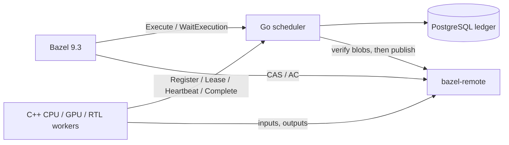

# Design

## Components and protocol



**The scheduler** (`scheduler/`) implements REAPI v2 `Capabilities` and
`Execution` (`Execute`, `WaitExecution`). It also serves its own worker
protocol (`api/worker/v1/worker.proto`): Register, Lease, Heartbeat and
Complete.
- It never stores or forwards blob bytes. Bazel and the workers talk to
  bazel-remote for CAS and AC directly.
- The scheduler itself reads only the Action, the Command and the output
  Trees, and writes action-cache entries.

**Workers** (`worker/`, C++20) do the following for each attempt:
1. lease one action;
2. fetch its input tree into a fresh attempt directory;
3. run the command in its own cgroup v2, with OOM and CPU accounting;
4. upload the outputs;
5. report completion.

A GPU worker reads its device identity from NVML before it leases, and
again before it runs. The scheduler matches the properties the worker
reports; it has no way to check them.

**Platform properties** come from Bazel `exec_properties` and are matched
exactly. That covers `OSFamily`, `ISA`, `pool` (`cpu`, `gpu`, `rtl`),
`image`, `gpu.cc` and `gpu.driver_major`. `cpu.min` and `mem_gb.min` are
lower bounds. An action that no live worker satisfies fails with
FAILED_PRECONDITION, rather than waiting forever.

## Leases, epochs and fencing

An execution goes through these states:

```
Queued ──lease──▶ Leased ──RUNNING──▶ Running ──UPLOADING──▶ Uploading ──Complete──▶ Committed ──AC write──▶ Published
   ▲                                                                       │
   └────────── Retrying (lease expired or infrastructure failure, epoch+1) ◀┘
```

- **Leases.** Each lease is an Attempt with `(worker, epoch)`. It lasts
  30 s and is renewed by heartbeats every 10 s.
- **Fencing.** A heartbeat or Complete is accepted only if it carries the
  execution's current epoch, comes from the leasing worker, and arrives
  before the scheduler-side deadline. Anything else is FENCED.
- **Expiry and retry.** An expired lease bumps the epoch and makes the
  execution retryable. After three attempts it becomes `InfraFailed`.
- **Worker-side expiry.** A worker measures its own lease from the start
  of its last acknowledged heartbeat, so it always gives up no later than
  the scheduler does. Until then it rides out an unreachable scheduler:
  heartbeats, phase changes and Complete that fail in transport are
  retried, and every RPC to the scheduler waits for the channel to
  reconnect within its deadline. Only an explicit FENCED or CANCEL
  decision, or expiry, ends an attempt early. Retrying Complete is safe: a
  replay of the committed winner is ACCEPTED without changing it, and a
  fenced attempt stays FENCED.
- **What Complete must show before it can commit:**
  - the worker reports the attempt's cgroup empty, so no process should
    still write outputs (the scheduler trusts this report);
  - the attempt directory was never used by an earlier attempt;
  - for a success, the command was reported started;
  - an OOM kill recorded by the cgroup overrides a successful exit;
  - after the lock is released, every output blob is present in the CAS
    (a walk of the output Trees plus `FindMissingBlobs`).
- **Then the lock is retaken and the attempt fenced again,** because the
  lease may have expired during that walk.

## Commit, then publish

A result is first made durable in the ledger (`Committed`). Only then is it
written to the action cache (`Published`).

- **Order.** A crash between the two leaves a committed result that is
  published on recovery, after its blobs are checked again. Nothing ever
  appears in the action cache that the ledger does not hold.
- **Never cached:** hardware tests, `do_not_cache` actions and unsuccessful
  results.
- **No re-execution on cache failure.** An action-cache outage never turns
  a committed winner into a new epoch; `Tick` retries the same result.
- **Off the lock.** Publication calls the cache without the scheduler lock,
  one publisher per execution at a time. Holding the lock through
  `ReadBlob`, `FindMissing` and `UpdateActionResult` would let one slow cache
  call stall every heartbeat and expire leases behind it
  ([design-tradeoffs.md](design-tradeoffs.md#commit-then-publish)).
- **Not a pin.** The CAS check before publication does not stop
  bazel-remote from evicting a blob afterwards; bazel-remote's own
  dependency checks on cache reads are the guard.

## The ledger

The scheduler keeps the whole ledger in memory and persists it to
PostgreSQL. It runs as a single leader, which holds a PostgreSQL advisory
lock on its connection.
- The ledger holds executions, attempts and an append-only event log.
- Each mutation is one transaction:
  - it copies a row the first time it writes it;
  - it produces a `Change`: exactly the rows it touched and the events it
    appended.
- **Group commit.** Under the lock, the change is installed in the indexed
  in-memory ledger and appended to a commit log, and the lock is released.
  One writer saves every change appended while its previous write was in
  flight as a single PostgreSQL transaction, with the last version of each
  row and every event in order.
- **Answers wait for durability.** A call answers only once the log is
  durable up to the position it observed, its own changes included, so no
  client sees state that a crash could lose. Publication to the action
  cache, and the audit metadata Complete sends to the cache, wait too. Two
  answers skip the wait, because no lost change could contradict them: an
  empty lease, and a heartbeat that changes nothing and gets CONTINUE (the
  store always holds a prefix of memory, so nothing durable fences that
  attempt either).
- So committed rows are never modified in place, and a commit costs
  O(rows touched).
- **Indexes.** The lookups RPCs need are indexed: rows by ID; runnable
  executions, in a min-heap of ledger positions per distinct platform, so a
  Lease looks at the oldest execution of each platform the worker matches
  instead of sorting the whole queue; the in-flight execution per action
  digest, which identical requests join; and attempt directories already
  used.
- **Wakeups.** Execute and WaitExecution streams wait on their own
  execution only.
- **Fail-stop.** If a ledger write fails, memory is ahead of the store, so
  the scheduler stops instead of serving it; the writer marks it failed
  before any waiter learns of the failure, so no later call is answered
  from memory. A restart reloads the durable prefix.
- **Restart.**
  - Leases in flight get a fresh grace period, and workers re-register as
    soon as the restarted scheduler asks them to.
  - An attempt whose scheduler is back within its lease finishes and
    commits at its own epoch. After a longer outage the recovered lease
    expires and the action is retried.
  - Until that grace ends, an action no live worker matches stays queued
    instead of failing.
- **Audit export.** `/audit/durable-export` reads the store on its own
  connection, so an audit read can neither block commits nor stop the
  scheduler.

An action takes about six commits (created, leased, running, uploading,
committed, published). Made one at a time under the scheduler lock, they
capped the ledger at 104–124 actions/s across ten load-test runs and put an
fsync in front of every heartbeat. With group commit and 64 synthetic
workers, 27.5 changes share each transaction and the ledger reaches
1,173–1,603 actions/s over ten runs (`results/control-plane.jsonl`). Each
worker still waits for its own commits, so
throughput is bound by commit latency: more concurrent callers make bigger
groups.

## Regression tooling

`remex` (`cmd/remex`, `regress/`) works from Bazel's Build Event Protocol and the
scheduler ledger.

**Classify.** Each test outcome is one of:
- PASS;
- TEST_FAILURE, with a signature;
- TIMEOUT;
- INFRASTRUCTURE: lost worker, OOM, scheduler-side failure;
- CANCELLED;
- UNKNOWN: a cached result, which is not fresh evidence.

The signature is a `REMEX_SIGNATURE:` line printed by the test, or else the
digest of the test log.

**Select.** Hardware tests (GPU, RTL) are expensive. `remex select` keeps the
ones `target-determinator` reports as affected by a change. It runs all of
them if a global file changed or the selector fails.

**Bisect.** It is built for flaky failures:
1. Calibrate on the known-bad revision until it has failed 10 times (at most
   200 runs).
2. Take a one-sided Clopper–Pearson lower bound `p_lo` on its failure rate.
   The bound stays exact under this stopping rule, because the chance the
   r-th failure comes within n runs is P(Binomial(n, p) ≥ r).
3. Run each probe `K = ⌈ln α / ln(1 − p_lo)⌉` times, so a bad revision
   escapes detection with probability at most α. A matching failure ends
   the probe early.
4. Classification rules:
   - infrastructure failures consume budget but count as no evidence;
   - a different failure signature makes a revision unclassifiable
     (skipped).
5. Confirm the final boundary with 2K fresh runs on each side, with no early
   stopping.
6. Otherwise report `RANGE` or `INCONCLUSIVE`; never guess.

**Bundles.** `remex export` packs an action's inputs, Command and environment
into an offline bundle, and `scripts/replay-isolated.py` re-runs it without
the build system.

## Checker

`checker/` is an independent module. It records the gRPC traffic between
Bazel, the scheduler and the cache through a proxy, then checks invariants
against that recording and the durable ledger:
- an AC entry is published only after its commit;
- there is one winner per execution;
- no complete is accepted at a stale epoch;
- the results it checks exist in the CAS.
